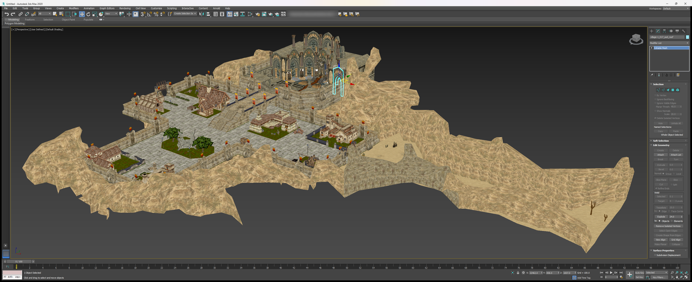
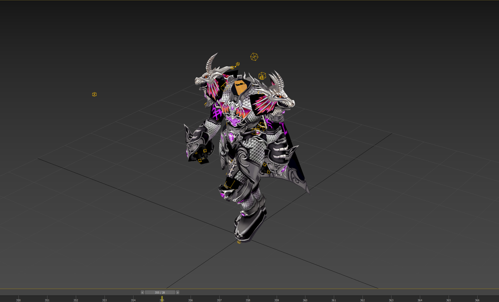
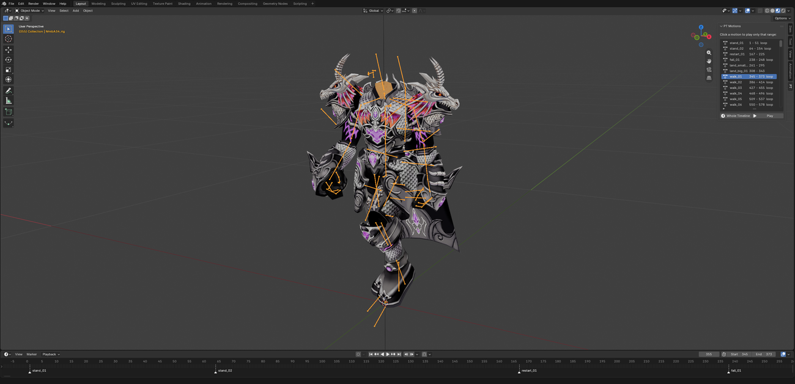
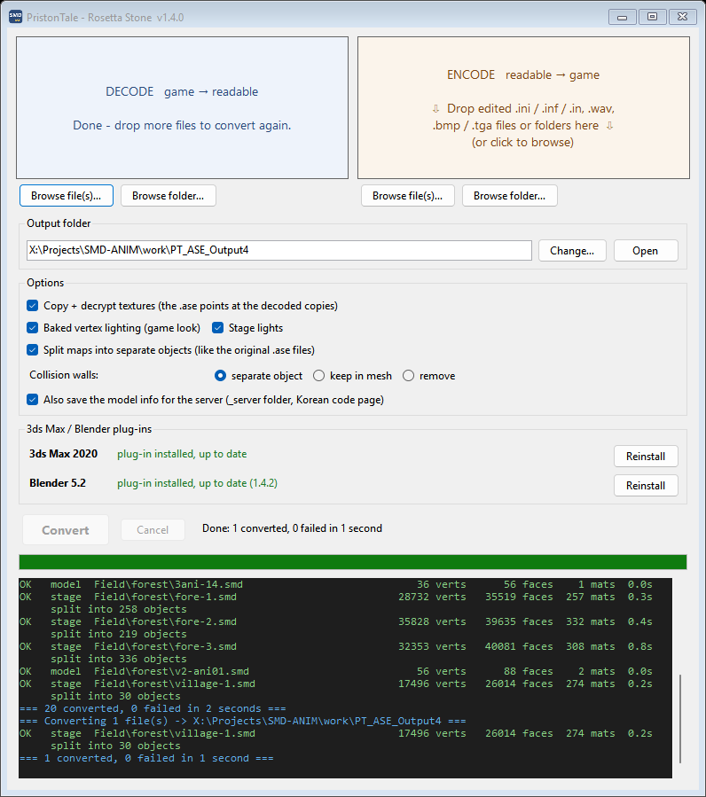

# Priston Tale SMD → ASE Converter

Open Priston Tale's game models in **3ds Max** and **Blender**, edit them, and export them back for the game.

The converter turns the game's `.smd` / `.smb` files back into `.ase`, the 3ds Max format the game was originally made
with. The plug-ins import them with textures, skeletons and animation, and export your edits back to `.ase` in the same
layout as the developers' own files, so the game can rebuild its `.smd` / `.smb` from them.

**[⬇ Download the latest release](https://github.com/sungam3d/Pristontale-SMD-to-ASE-Converter/releases/latest)**
(Windows 10/11, nothing to install)

## What it does

| | Import | Export |
|---|---|---|
| **Maps** | Every zone in its real world position, so maps line up as in the game. Split into separate objects (terrain, buildings, trees…), each with its own pivot. Game lighting, lightmaps and collision walls included. | Yes |
| **Weapons and items** | Swords, axes, staffs, armour, shields and other drop items. | Yes |
| **Monsters** | Skinned to their skeleton, with every animation (stand, walk, run, attack, die…). | Mesh, bones, skin and animation |
| **Characters** | Player armour, heads and costumes on their class skeleton, with the whole class animation and a clickable list of motions. | Mesh, bones and skin (the game takes the animation from the class file) |
| **Original developer `.ASE` files** | Can be animated with the class animation, or shown in their bind pose. | Yes |

Models are checked against the game's own maths: they move the same as in the game, and import → export gives back the
same bones, skin and animation.

  
  

## Quick start

1. **Convert.** Run `PT_SMD2ASE.exe` and drag a `.smd` file or a whole folder from your Priston Tale client onto it:
   `Field\` for maps, `char\monster\` for monsters, `char\tmABCD\` for characters,
   `image\Sinimage\Items\DropItem\` for weapons and items.
2. **Install the plug-in** for your program:
   - **3ds Max 2020 or newer:** copy the three files from `3dsMax\` into `<3ds Max>\scripts\startup\` and restart Max.
   - **Blender 4.2 or newer:** Edit → Preferences → Get Extensions → ⌄ → Install from Disk… → `Blender\pt_ase_importer.zip`.
3. **Import** the `.ase` files. Characters and monsters come in animated: pick a motion from the PT Motions list
   (3ds Max) or the PT tab (Blender) and press play.
4. **Edit, then export** with the original file name.

The download includes an illustrated step-by-step guide for each program (`Guide_3dsMax.html`, `Guide_Blender.html`),
covering every feature and exactly which files to replace when you put your work back into the game.
**Back up your game folder first**, and try one file at a time.

## What's in this repository

| Folder | Contents |
|---|---|
| `src\` | The converter in C#: drag-and-drop app, command-line app and library, plus the guides and the release build script |
| `smdanim\`, `char2ase.py` | The same converter in Python (the reference; the C# output is byte-identical to it) |
| `tools\max\` | 3ds Max import/export scripts |
| `tools\blender\` | Blender import/export add-on |
| `scripts\` | Verification scripts used to check the converter and plug-ins against the game |
| `docs\TECHNICAL.md` | How the `.smd` / `.smb` / `.inx` formats work and what was verified |

Building: run `src\build_release.cmd` (needs the .NET 8 SDK and Python 3). See [src/README_SOURCE.md](src/README_SOURCE.md).

No game files are included. You need your own Priston Tale client.

## Known limits

- Monsters that keep their animation in a separate motion file can have their model and skin edited, but not their
  animation replaced yet.
- The game's own rebuild from `.ase` can only be tested in the game: please report what you find.

## Licence

[MIT](LICENSE), except the Blender add-on (`tools/blender/io_scene_pt_ase/`), which is GPL-3.0-or-later as Blender
requires for add-ons.

This is a fan-made tool and isn't affiliated with or endorsed by the makers of Priston Tale. Priston Tale and its game
data belong to their respective owners.
