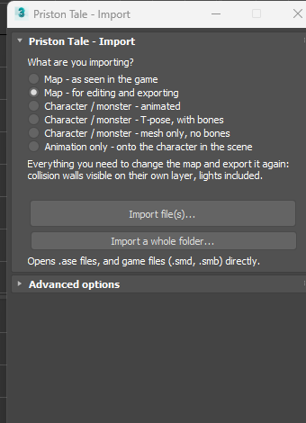
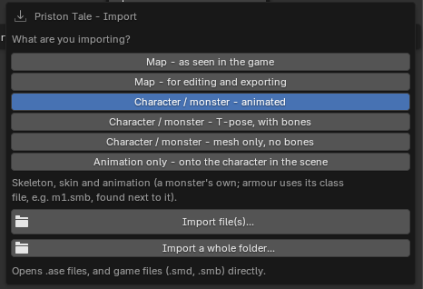
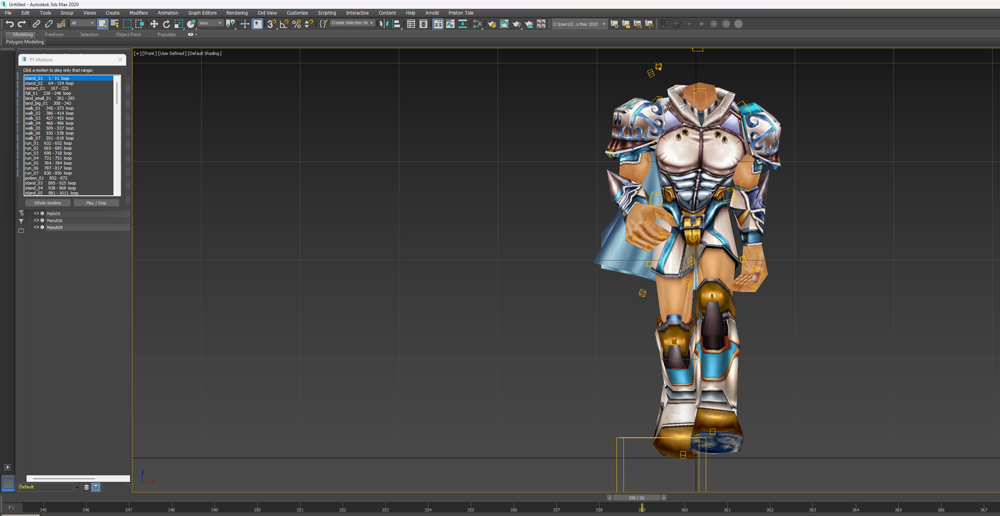
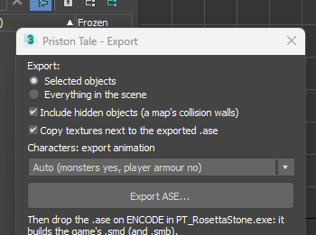
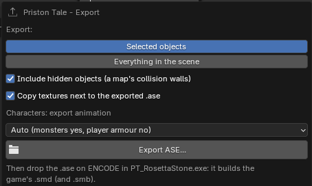

# PristonTale - Rosetta Stone

**Decode Priston Tale's game files into formats you can open and edit, then encode your work back for the game.**
Models and maps go to 3ds Max and Blender with their textures, skeletons and animation; textures, sounds, Korean text
and compiled model info come out as ordinary files any program reads.

**[⬇ Download the latest release](https://github.com/sungam3d/PristonTale-Rosetta-Stone/releases/latest)**
&nbsp;·&nbsp; Windows 10/11, nothing to install &nbsp;·&nbsp; free and open source


*(Formerly "PT SMD → ASE Converter".)*

### New in 1.5.0

- **Both ways:** ENCODE now builds edited `.ase` maps and models back into the game's `.smd` / `.smb`, as the game's
  own builder does (current clients and 2012 clients), with a warning where too many faces would crash the game.
- **9 languages:** English, 한국어, 简体中文, 繁體中文, 日本語, ไทย, Tiếng Việt, Português (Brasil) and Español, for the
  window, the log, the notes and both plug-ins.
- **3ds Max plug-in reworked:** one-click import choices, an *Animation only* import onto a character, a separate
  export window, and `.smd` / `.smb` opened straight from the game folder.
- **Exact round trip:** vertex colours, material colours and model matrices now decode exactly, so decode → encode
  gives the game's files back.

---

## Contents

- [New in 1.5.0](#new-in-150)
- [What it does](#what-it-does)
- [Getting started](#getting-started)
- [DECODE: game files → readable](#decode-game-files--readable)
- [Models in 3ds Max and Blender](#models-in-3ds-max-and-blender)
- [The plug-ins: install, import, export](#the-plug-ins-install-import-export)
- [ENCODE: your edits → game files](#encode-your-edits--game-files)
- [Putting your work back into the game](#putting-your-work-back-into-the-game)
- [Command line](#command-line)
- [Problems?](#problems)
- [Credits](#credits) · [Source code](#source-code) · [Licence](#licence)

---

## What it does

| | |
|---|---|
| **Models and maps** | `.smd` / `.smb` → `.ase`, the 3ds Max format the game was made with. Maps in their real world position, split into objects; weapons and items; monsters skinned and animated; player armour, heads and costumes on their class skeleton with every class motion. |
| **Textures** | The game scrambles the header of every `.bmp` / `.tga`. They come out as normal images, including a few the developers scrambled twice. |
| **Sounds** | The game's `.wav` files start with `JODO` instead of `RIFF`. They come out playable, and so does the music (`.bgm`). |
| **Text** | `.ini` `.inf` `.in` `.sin` `.msg` `.txt` `.lua` … are Korean in code page 949. They come out as UTF-8, readable in any editor. |
| **Model info** | Every compiled `.inx` (monsters, NPCs, player models) is rebuilt as the `.ini` / `.inf` / `.in` it was made from: model files, detail levels, and every animation's frames and key events. |
| **Languages** | The window, log, notes and plug-ins in English, Korean, Chinese (simplified and traditional), Japanese, Thai, Vietnamese, Brazilian Portuguese and Spanish. The guides are in English; a browser translator turns them into any language. |
| **3ds Max and Blender plug-ins** | Import with textures, skeletons and animation in one click (map as in the game, map for editing, character animated or in T-pose, or just a new animation onto a character); export back to `.ase` in the same layout as the developers' own files. Installed with one click. |
| **Back to the game** | Edited maps and models (`.ase`) are built into the game's `.smd` / `.smb` the way the game's own builder does it; model info, textures, sounds and text go back into the exact forms the game reads. Checked against the game's own builds: 41 maps and 337 models of 2012, and every map and model of a current client decoded and built again. The `.inx` compiler gives byte for byte the game's own (all 2 455 `.inx` files of a current client). |

<p>
  
  
</p>

---

## Getting started

1. **Download** the latest release and unzip it anywhere. Start **`PT_RosettaStone.exe`**.
   (If Windows says *"Windows protected your PC"*: **More info → Run anyway**. The program isn't signed.)
2. **Install the plug-in** for 3ds Max and/or Blender with the **Install** button in the window ([below](#install)).
3. **Drop** your Priston Tale folder, or any folder or file from it, on the blue **DECODE** box.
4. **Open** the `.ase` files in 3ds Max or Blender, and everything else in any image, sound or text editor.
5. **Edit**, export from 3ds Max / Blender, and drop your edited files on the orange **ENCODE** box.

> **Back up your game folder first**, and try one file at a time in the game.

The download also has an illustrated step-by-step guide for each program: `Guide_3dsMax.html` and `Guide_Blender.html`.

---

## DECODE: game files → readable

Drop files or folders on the **DECODE** box, click it, or use **Browse file(s)… / Browse folder…** under it.
There is nothing to choose: the window looks at what you dropped.

- **The whole game folder**, or any folder with sounds, text or `.inx` in it: every kind of file is converted into the
  output folder, in the game's own folder layout.
- **Only `.smd` files** (a map folder, a monster): the models are converted to `.ase`, with their textures.
- **One file** is converted straight away. For a folder the window first says what's in it and how long it will take:
  tick *I understand, continue* and click **Convert**.

| Game file | Becomes |
|---|---|
| `.smd` (+ `.smb`) models and maps | `.ase`, with its textures |
| `.bmp` / `.tga` textures | normal images |
| `.wav` sound effects | playable `.wav` |
| `Name.bgm` music | `Name.bgm.wav` (plays anywhere, goes back as `Name.bgm`) |
| `.ini` `.inf` `.in` `.sin` `.msg` `.txt` `.lua` … | UTF-8 text |
| `.inx` model info | the `.ini` / `.inf` / `.in` it was compiled from |


The output folder mirrors the game:

```
PT-Readable\
  char\monster\Tees\Tees.ase     the model, skinned and animated
  char\monster\Tees\Tees.tga     its texture, readable
  char\monster\Tees\Tees.ini     its model info, rebuilt from Tees.inx
  Field\forest\fore-1.ase        a map, split into its objects
  wav\Effects\...\damage 1.wav   a sound effect, playable
  wav\BGM\Field - Desert - Pilgrim.bgm.wav     music
  _server\char\...\Tees.ini      the model info again in the game's Korean code page (for the server)
  missing_textures.txt           textures the models name but the game doesn't have
```

### Options

| Option | What it does |
|---|---|
| Copy + decrypt textures | Writes readable copies of the textures; the `.ase` points at them. Leave it ticked. |
| Baked vertex lighting | Keeps the game's lighting and shadows on maps. Leave it ticked: ENCODE gives the map exactly this lighting back. |
| Stage lights | Writes a map's light points (lamps, fires) as lights. |
| Split maps into separate objects | Cuts a map into terrain, buildings, trees… close to how the original `.ase` files were made. Untick for one mesh. |
| Collision walls | The invisible walls of a map: separate object (easy to hide), keep in mesh, or remove. |
| Also save the model info for the server | The `_server` copy of the model info in the game's own code page. |


### Where things are in the game folder

| Folder | Contains |
|---|---|
| `Field\` | Maps, and the objects placed on them (trees, buildings, animated props) |
| `image\Sinimage\Items\DropItem\` | Weapons (`itW…`), armour, shields and other items |
| `char\monster\` | Monsters, one folder each |
| `char\tmABCD\` | Player armour (bodies), heads and costumes, and the class motion files |
| `char\npc\` | NPCs |
| `wav\` | Sound effects and music |

---

## Models in 3ds Max and Blender

| | Import | Export |
|---|---|---|
| **Maps** | Every zone in its real world position, so maps line up as in the game. Split into objects (terrain, buildings, trees…), each with its own pivot. Game lighting, lightmaps and collision walls included. | Yes |
| **Weapons and items** | Swords, axes, staffs, armour, shields and other drop items. | Yes |
| **Monsters** | Skinned to their skeleton, with every animation (stand, walk, run, attack, die…). | Mesh, bones, skin and animation |
| **Characters** | Player armour, heads and costumes on their class skeleton, with the whole class animation and a clickable list of motions. | Mesh, bones and skin (the game takes the animation from the class file) |
| **The developers' own `.ASE` files** | Animated with the class animation, or in their bind pose. | Yes |

Models are checked against the game's own maths: they move the same as in the game, and import → export gives back the
same bones, skin and animation.

<p>
  
  
</p>
<p>
  
  
</p>

Characters share their class's animation file, which the converter writes next to the armour:

| File names | Class | Animation file |
|---|---|---|
| `TmbA` `TmbB` `MmbA` | Mechanician, Fighter, Knight | `m1_motions.ase` |
| `TfbD` `MfbB` | Archer, Atalanta | `m2_motions.ase` |
| `MmbD` | Magician | `m3_motions.ase` |
| `TmbC` | Pikeman | `m4_motions.ase` |
| `MfbC` | Priestess | `m5_motions.ase` |
| `TfbE` | Assassin | `m6_motions.ase` |
| `MmbE` | Shaman | `m7_motions.ase` |
| `TfbF` | Martial Artist | `m8_motions.ase` |

(`b` = body, `h` = head, `m` / `f` = male / female, a leading `C` = costume.)

---

## The plug-ins: install, import, export

### Install

The window finds every 3ds Max (2020 or newer) and Blender (4.2 or newer) on your PC, and shows an **Install**,
**Update** or **Reinstall** button for each.


- **3ds Max:** the plug-in goes into your own scripts folder, so it needs no administrator rights. If you put an older
  copy into 3ds Max's own folder by hand, that copy is updated where it is (Windows asks for permission). Restart Max:
  a **Priston Tale** menu appears in the menu bar (**Import… / Export… / Motions…**), and the importer and exporter
  are also under **File → Import** and **File → Export**. The installer also tells the plug-in where the converter is,
  so it opens the game's own `.smd` / `.smb` files directly.
- **Blender:** Blender installs and switches on the add-on itself. Close Blender first.

By hand: copy the four files from the release's `3dsMax\` folder into `<3ds Max>\scripts\startup\`. In Blender,
**Edit → Preferences → Get Extensions → ⌄ → Install from Disk…** and pick `Blender\pt_ase_importer.zip`.

<p>
  
  
</p>

### Import

- **3ds Max and Blender** have the same import window: **Priston Tale → Import…** (top menu bar; in Blender also
  **File → Import → Priston Tale (.ase, .smd, .smb)**). Answer *What are you importing?* with one click, then **Import file(s)…**
  (`.ase`, or the game's `.smd` / `.smb` directly) or **Import a whole folder…**:

  | Choice | Gives you |
  |---|---|
  | Map – as seen in the game | textures and baked lighting exactly as in the game; collision walls hidden |
  | Map – for editing and exporting | everything to change the map and export it again: collision walls visible on their own layer, lights included |
  | Character / monster – animated | skeleton, skin and animation (armour uses its class file, e.g. `m1.smb`, found next to it) |
  | Character / monster – T-pose, with bones | skeleton and skin in the bind pose, no animation |
  | Character / monster – mesh only | the mesh without a skeleton |
  | Animation only | puts another animation file (`m1.smb` … `m8.smb`, or a monster's) on the character already in the scene |

  The single settings are under **Advanced options** (closed); each choice fills them in (Blender: on the right of the
  file browser).

  <p>
    
    
  </p>

Characters and monsters come in skinned and animated. Pick a motion from the **PT Motions** list (3ds Max:
**Priston Tale → Motions…**) or the **PT** tab of the side panel (press **N**, Blender) and press play.



<p>
  
  
</p>

Textures are found next to the `.ase`, anywhere in the converted output folder (also after you move or share it), or in
an **Extra texture folder** you pick; the game's own scrambled textures work there too.

### Export

**Priston Tale → Export…** in 3ds Max and Blender (Blender also **File → Export → Priston Tale (.ase)**): *Selected
objects* or *Everything in the scene*; keep *Include hidden objects* ticked for maps, their collision walls are hidden.
Save with the **same name as the original `.smd`**. Keep *Copy textures* ticked. Then drop the `.ase` on **ENCODE**.

<p>
  
  
</p>

Characters and monsters are written with the mesh in its rest pose, every bone, which bone each vertex follows (the game
uses one bone per vertex) and, for monsters, the animation. Keep the material names: they hold the game's keywords
(`wind:`, `wall:`, `BLEND_LAMP:` …).

---

## ENCODE: your edits → game files

Drop your edited files, or the whole output folder, on the orange **ENCODE** box. The game-format files go to
`game_format` in the output folder, in the game's folder layout:

| You edited | Becomes |
|---|---|
| `.ase` map | the map's `.smd`, built the way the game builds it |
| `.ase` model (weapon, item, map prop, monster, armour) | its `.smd`, and the `.smb` (bones and animation) for a monster with its animation inside, a motion file or a prop on bones |
| `.ini` / `.inf` / `.in` model info | `.inx`, byte for byte what the game compiles, plus the text in the game's code page |
| `.bmp` / `.tga` | the game's scrambled texture |
| `.wav` | the game's sound header |
| `Name.bgm.wav` | `Name.bgm` |
| other text | the game's Korean code page |

The game's loaders are much stricter than image and sound editors, so Encode also puts files into the one layout the
game reads: RLE-packed TGAs (GIMP's default) are unpacked, a TGA image ID is left out, grey images become colour,
upside-down BMPs are flipped, and wave files with extra chunks (most sound editors add them) are rewritten.

**Read the `note` lines in the log.** They say what was changed, or what the game would not read the way you meant:
an unknown weapon, class or skill name, a `// comment` after a motion's frames, a character the Korean code page
doesn't have, a float or 24-bit sound, or too many faces in one spot of a map.

An `.ase` outside a game folder still lands in the right place: a map exported from one the converter made is named after
it (`village2.ase` → `field\ricarten\village-2.smd`), a model goes to the game folder its textures came from. A map keeps
the lighting the game's map had (two settings exist; the right one is picked for every map of the game).

**Keep detail low where characters walk.** For walking, older clients (built on the 2012 code) take the faces of the
few metres around a character into a list of 1000, and crash when there are more; every original map stays under that.
ENCODE warns with the place in 3ds Max coordinates: a 4096-face teapot does it, a box does not.


- Keep the game's folder names (`char\monster\Tees\…`): an `.inx` stores a checksum of its own path.
- Dropping the whole output folder is fine: its `_server` copy and any earlier `game_format` output are left out.

---

## Putting your work back into the game

1. **Back up** the original files.
2. Export with the **same name** as the original `.smd` (`fore-1.ase` for `fore-1.smd`, `Tees.ase` for `Tees.smd`).
3. Drop the `.ase` (and its textures, model info, sounds …) on **ENCODE**.
4. Copy what ENCODE wrote into `game_format` over the game's files:

| Model | ENCODE writes | The game keeps using |
|---|---|---|
| Maps, map objects, weapons, items | its `.smd` | |
| Player armour, heads, costumes | its `.smd` | the class files `m1.smb` … `m8.smb` |
| Monster with its animation in the same file (e.g. `Tees`) | its `.smd` and `.smb` | its `.inx` |
| Monster with a separate motion file (e.g. `MonGknight-model` + `mGknight`) | the model's `.smd` | the motion `.smb` and the `.inx` |
| A motion file (`m1.ase` … `m8.ase`, `mGknight.ase`) | its `.smb` | |

The game's own builder still works too: an `.ase` without a matching `.smd` next to it is built when the game starts,
in clients that kept that code.

---

## Command line

`smd2ase.exe` does everything the window does, for scripts and batch files:

```
smd2ase "<game>\Field" -o D:\PT-ASE --textures              models and maps -> .ase
smd2ase --client "<game>" -o D:\PT-Readable                 the whole game folder (like DECODE)
smd2ase --to-game D:\PT-Readable\char\monster\Tees -o D:\PT-Game    edited files (also .ase) -> game (like ENCODE)
smd2ase --check-inx "<game>"                                every .inx decompiles and compiles back exactly?
smd2ase --help                                              every option
```

---

## Problems?

| | |
|---|---|
| **The Priston Tale menu is missing in 3ds Max** | Check the window shows the plug-in as installed (or that the 4 files are in `scripts\startup`), then restart 3ds Max. The macros are also under **Customize → Customize User Interface → Category "PT Tools"**. |
| **The game crashes near something I added** | Too many faces in one spot: read the ENCODE note and use a simpler model there. |
| **The model is white or untextured** | Keep the output folder together, or set *Extra texture folder*. Textures the game itself doesn't have are listed in `missing_textures.txt`. |
| **A character comes in T-pose** | Check *Pose* is *Animated* and the class file (`m1_motions.ase` … `m8_motions.ase`) is next to the `.ase`. |
| **The add-on is missing in Blender** | Close Blender, click **Reinstall** in the window, and start Blender again. |
| **Nothing shows after importing** | Maps sit far from the centre: zoom to everything (Shift+Ctrl+Z in 3ds Max, Home in Blender). |
| **The game doesn't show my change** | Check the file name matches the original, the files from `game_format` replaced the game's (table above), and read the ENCODE notes. |

Known limits: a class motion file (`m1.smb` …) comes back as one continuous timeline rather than the pieces the game
joined it from (the game plays it the same way). Please report what you find in the game.

---

## Credits

- **Sandurr** for **SMD Reader** (2010), the original `.smd` / `.smb` → `.ase` converter. Its source was
  the first map of the game's model and bone files, and the model conversion here grew from it.
- **[bobsobol](https://forum.ragezone.com/threads/pt-file-patcher.684994/)** for **PT File Patcher** (and TGAPatch
  before it), the tool that first made Priston Tale's `.tga`, `.bmp`, `.wav` and `.bgm` files open in ordinary image and
  sound editors, shared with its source on RaGEZONE. Rosetta Stone's texture and sound decoding stands on that work, and
  on **Obscura**'s BMPPatcher and WAVPatcher that it built on.
- The Priston Tale community on RaGEZONE, for years of shared research.

---

## Source code

| Folder | Contents |
|---|---|
| `src\` | The program in C#: the window (`PT_SMD2ASE\`), the command line (`smd2ase\`) and the library (`PTSmd\`), plus the guides and the release build script |
| `smdanim\` | The same converter in Python, the reference: the C# output is byte-identical to it |
| `tools\max\`, `tools\blender\` | The 3ds Max and Blender plug-ins |
| `scripts\` | The checks used to verify the converter and plug-ins against the game |
| `docs\TECHNICAL.md` | How the game's formats work (`.smd`, `.smb`, `.inx`, the scrambled headers, what the game's loaders accept) and what was verified |

Build with `src\build_release.cmd` (needs the .NET 8 SDK and Python 3). See [src/README_SOURCE.md](src/README_SOURCE.md).
No game files are included: you need your own Priston Tale client.

## Licence

[MIT](LICENSE), except the Blender add-on (`tools/blender/io_scene_pt_ase/`), which is GPL-3.0-or-later as Blender
requires for add-ons.

This is a fan-made tool and isn't affiliated with or endorsed by the makers of Priston Tale. Priston Tale and its game
data belong to their respective owners.
